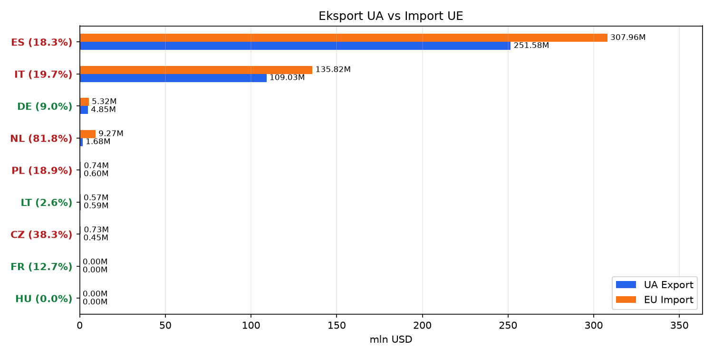
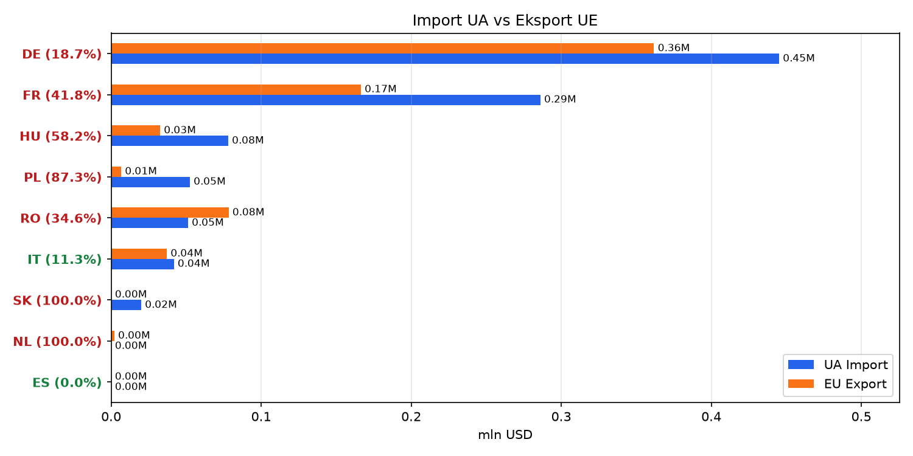

# UA–EU Trade Mirror ETL

An object-oriented ETL pipeline in Python that collects official foreign trade statistics from the **State Customs Service of Ukraine** and reconciles them against mirror import/export data from **Eurostat Comext** (demonstrated on wheat trade, `HS 1001`).

## Key Capabilities & Architecture

1. **Extract (Automated Web Scraping & API Ingestion):**
   - [`ukraine_customs.py`](src/ua_ue_trade_mirror_etl/extractors/ukraine_customs.py) — **Playwright** scraper built using the **Page Object Model (POM)** pattern to navigate `bi.customs.gov.ua`, apply dynamic filters, and download raw `.xlsx` trade reports with explicit timeout and error handling.
   - [`eurostat_comext.py`](src/ua_ue_trade_mirror_etl/extractors/eurostat_comext.py) — **httpx** client fetching monthly SDMX-CSV series from the Eurostat Comext API (`FLOW 1+2`) and converting EUR values to USD using current rate from **NBP API**.

2. **Transform & Validate (Irregular File Parsing & Schema Enforcement):**
   - [`cleaner.py`](src/ua_ue_trade_mirror_etl/transform/cleaner.py) & [`models.py`](src/ua_ue_trade_mirror_etl/models.py) — parses irregular, multi-header `.xlsx` customs exports (`pandas` + `openpyxl`), normalizes country/commodity codes, and enforces strict type and mathematical consistency checks (`Total ≈ Export + Import`, `Balance ≈ Export - Import`) via **Pydantic**.
   - [`reconciler.py`](src/ua_ue_trade_mirror_etl/transform/reconciler.py) — performs bidirectional mirror reconciliation (`UA Export ↔ EU Import` and `UA Import ↔ EU Export`) and flags bilateral discrepancies exceeding a configurable threshold (`15%`).

3. **Load, Observability & Visualization:**
   - [`storage.py`](src/ua_ue_trade_mirror_etl/storage.py) — exports clean, analysis-ready datasets (`ua_customs_clean.csv`, `trade_mirror.csv`, `anomalies.csv`) to `data/output/`.
   - [`logger.py`](src/ua_ue_trade_mirror_etl/logger.py) — structured logging and log rotation via **loguru** for diagnosing network failures, DOM changes, and validation errors.
   - [`generate_chart.py`](scripts/generate_chart.py) — generates publication-ready comparison charts in **matplotlib** for qualitative and economic analysis.

## Analytical Findings (`HS 1001` — Wheat, 2025)





- **Lithuania (`LT`: `$0.59M` UA vs. `$0.57M` EU, `2.6%` gap) & Germany (`DE`: `$4.85M` vs. `$5.32M`, `9.0%` export gap; `$0.45M` vs. `$0.45M`, `0.5%` import gap):** High bidirectional mirror consistency (`matches_all = True`).
- **Spain (`ES`: `$251.6M` UA vs. `$308.0M` EU, `18.3%` gap) & Italy (`IT`: `$109.0M` vs. `$135.8M`, `19.7%` gap):** Consistent ~18–20% positive spread on the EU side, reflecting standard **FOB vs. CIF** valuation differences (maritime freight and insurance included in EU import figures).
- **Poland (`PL`: `$0.74M` EU import), Hungary (`HU`: `$0M`), Slovakia (`SK`: `$0` trade):** Near-zero EU-reported imports reflect ongoing national import bans on Ukrainian wheat (transit shipments under customs supervision are excluded from national import statistics).
- **Netherlands (`NL`: `$1.68M` UA vs. `$9.27M` EU, `81.8%` gap):** Significantly higher EU-reported imports illustrate the classic **Rotterdam effect** (quasi-transit goods cleared through Dutch ports upon entering the EU single market before onward distribution).

## Project Structure

```text
├── src/ua_ue_trade_mirror_etl/
│   ├── config.py                  # Environment-based configuration (.env + defaults)
│   ├── logger.py                  # Structured logging & rotation (loguru)
│   ├── models.py                  # Pydantic data & validation schemas
│   ├── extractors/                # Playwright POM scraper (UA Customs) + httpx clients (Eurostat / NBP)
│   ├── transform/                 # Irregular .xlsx parser/cleaner + bidirectional mirror reconciler
│   ├── storage.py                 # CSV & anomaly report exporter
│   └── pipeline.py                # End-to-end ETL orchestration
├── scripts/generate_chart.py      # Comparison charts (matplotlib)
├── tests/                         # Offline unit tests (pytest + mocks + .xlsx fixtures)
├── pytest.ini
└── requirements.txt
